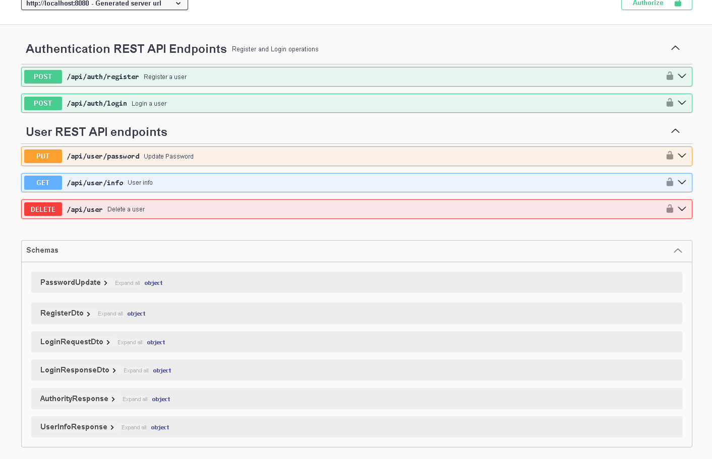

A *RESTful User Management* built with Java 21 and Spring Boot 4.1.2, featuring JWT-based authentication, user management, and secure API endpoints.

*Features*

JWT Authentication – Stateless authentication using JSON Web Tokens.

User Registration – Register new users.

User Login – Authenticate users and generate JWT tokens.

User Management – Retrieve, update, and 

delete user accounts.

Password Management – Secure password updates.

Role-Based Authorization – Access control using user roles and Spring Security.

Exception Handling – Centralized exception handling with structured JSON responses.

API Documentation – Interactive API documentation with Swagger UI.